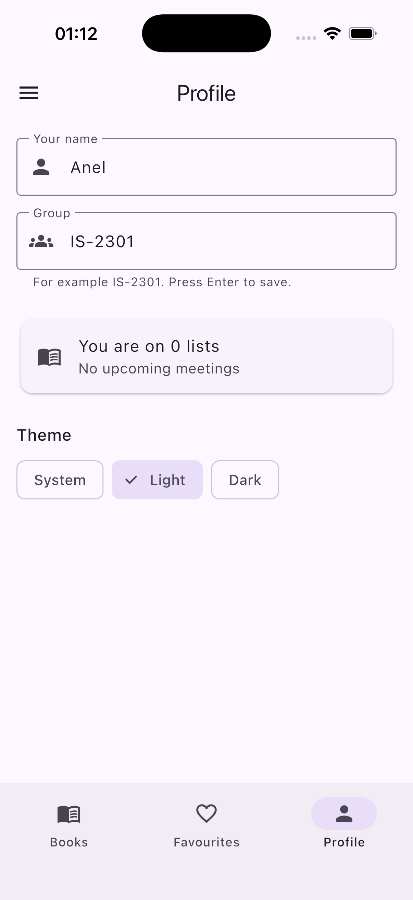
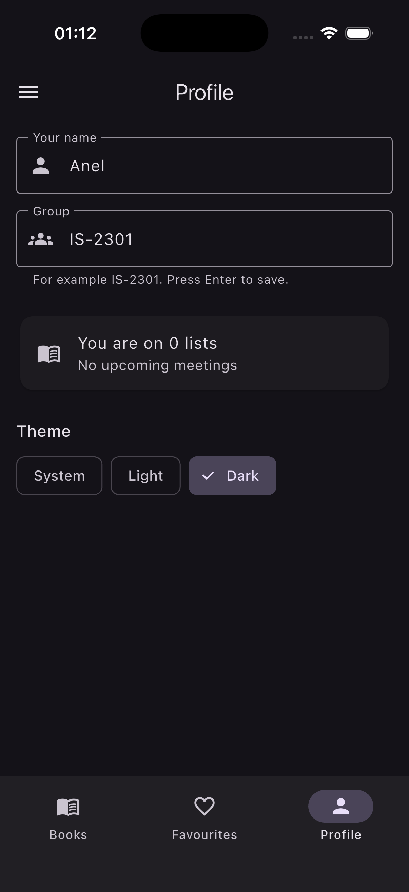
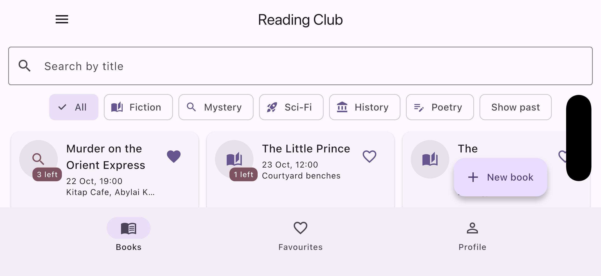

# Reading Club

Lab 1

A reading club app. Each **book** has one club meeting (date, place or online link), a number of **copies**, and a list of **readers** who borrowed one. You can search and filter the books, keep favourites, borrow or give back a copy, and add, edit or delete books. All data lives in memory.

| Part of the lab | In this app |
| --- | --- |
| Item | `Book` |
| category | `BookGenre` (Fiction, Mystery, Sci-Fi, History, Poetry) |
| when | `meetingAt` |
| limit | `copies` |
| the list | `readers` |
| mode | `isOnline` — the place becomes a link that must contain `://` |
| optional text | `notes` |
| primary action | Borrow / Give back |

## Screenshots

| Phone, light | Phone, dark | Tablet, grid |
| --- | --- | --- |
|  |  |  |

## Decisions

The list of books and the profile live in the shell's State, and every tab gets them as constructor parameters and sends changes back up through callbacks, so there is one source of truth. The detail screen receives the book and callbacks through its route arguments because it changes a book that the shell owns, while the form only produces a new value, so it returns a `Book` through `Navigator.pop` and the caller decides what to do with it. The grid is chosen with a `LayoutBuilder` because the decision should depend on the space the widget actually gets, not on the whole screen size. The form's `PopScope` compares the current field values with the values the form opened with, so it asks "Discard changes?" only when something really changed, and Save never asks. With week 9's tools I would move the books out of `setState` into shared state so screens stop passing callbacks around, and save the data so it survives a restart.
